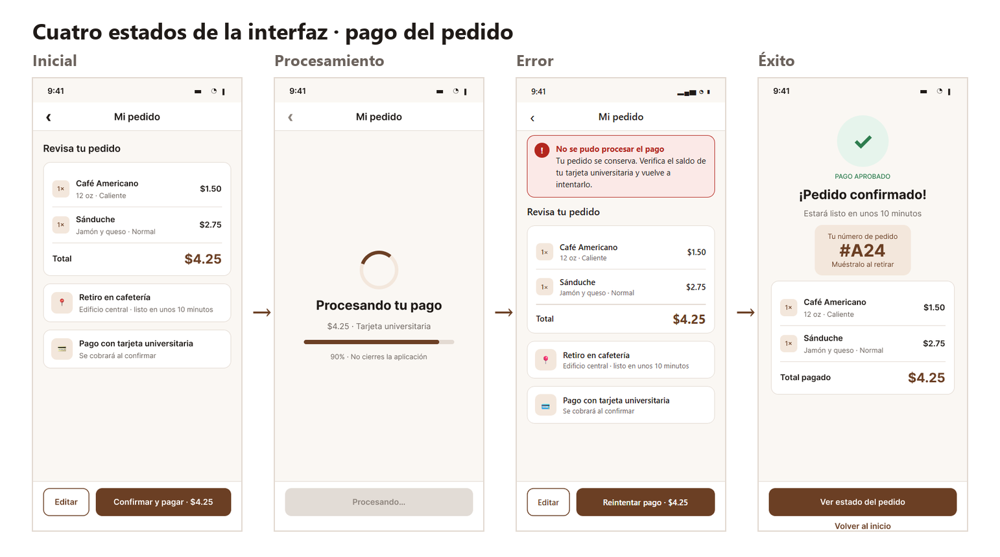
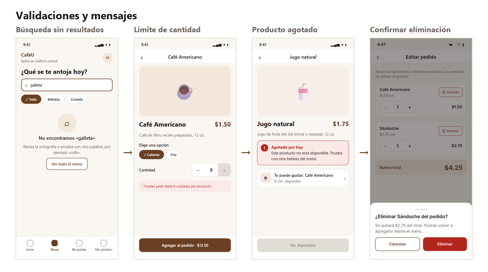
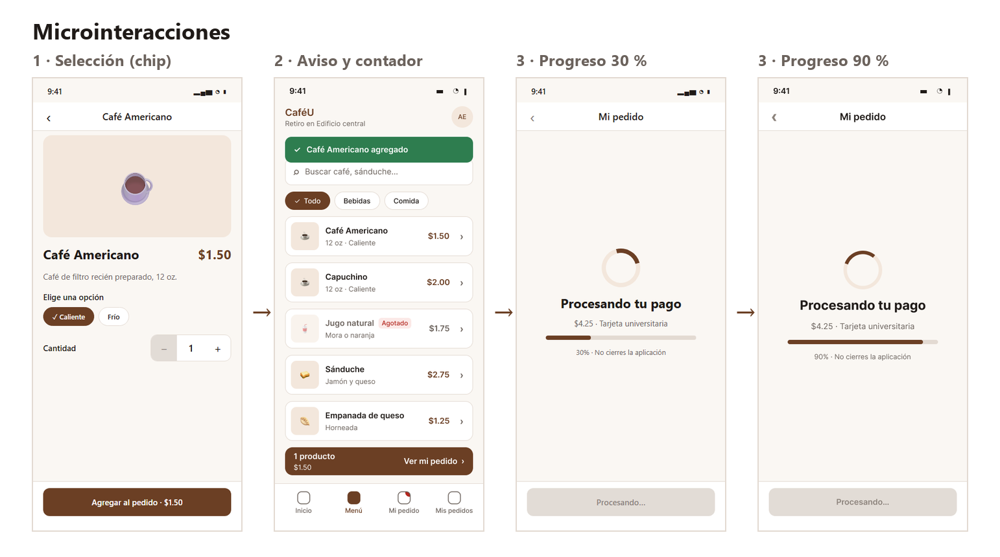

# 03 · Estados, feedback y microinteracciones — CaféU

## Cuatro estados de la interfaz (pago del pedido)

| Estado | Pantalla | Qué ve el estudiante | Feedback |
|---|---|---|---|
| Inicial | R4 · Resumen del pedido | Productos, total $4.25, retiro y método de pago | Botón principal «Confirmar y pagar · $4.25» con el monto visible |
| Procesamiento | R4p / R4q · Procesando pago | Indicador giratorio, barra 30 % → 90 %, «No cierres la aplicación» | Botón desactivado «Procesando…» y «‹» bloqueado para evitar doble cobro |
| Error | E1 · Pago rechazado | Mensaje «No se pudo procesar el pago» con la causa y qué hacer | El pedido se conserva; el botón cambia a «Reintentar pago» |
| Éxito | R6 · Pedido confirmado | ✓, «Pago aprobado», número #A24, tiempo y resumen pagado | Siguiente paso claro: «Ver estado del pedido» |

## Validaciones y mensajes

| Validación | Pantalla | Mensaje |
|---|---|---|
| Búsqueda sin resultados | R2s | «No encontramos «galleta»» + sugerencia y «Ver todo el menú» |
| Cantidad máxima (9) | R3v | «Puedes pedir hasta 9 unidades por producto»; «+» desactivado |
| Cantidad mínima (1) | R3, R5 | «−» desactivado en 1 |
| Producto agotado | E3 | «Agotado por hoy» + alternativa disponible; botón «No disponible» |
| Eliminar producto | R5d | Hoja de confirmación con el monto que se quita y «Cancelar» |
| Salir sin guardar | R5c | «¿Descartar los cambios?» con «Seguir editando» |
| Guardar sin cambios | R5 | «Guardar cambios» desactivado hasta que haya un cambio |
| Cambios guardados | R4b | Aviso verde «Cambios guardados · nuevo total $1.50» |

## Microinteracciones

| N.º | Tipo | Dónde | Cómo funciona en el prototipo |
|---|---|---|---|
| 1 | Selección | Filtros del menú y opciones del producto | Componente **Chip** con variantes Normal / Seleccionado; al tocarlo cambia con *Smart Animate* (Figma) o transición CSS (HTML) |
| 2 | Retroalimentación al agregar | R3 → R2b / R2c | Aviso verde «Café Americano agregado», contador en «Mi pedido» y barra «Ver mi pedido · $1.50» |
| 3 | Indicador de progreso | R4p → R4q → R6 | Temporizadores de 0,9 s y 0,7 s; la barra crece 30 % → 90 % con *Smart Animate* y pasa sola a la confirmación |
| 4 | Transición de hoja inferior | R5 → R5d, R5b → R5c | La hoja de confirmación sube desde abajo sobre un fondo oscurecido |
| 5 | Estado presionado | Botones (HTML) | El botón se reduce al 97 % y oscurece al presionarlo |
