# PRÁCTICA EXPERIMENTAL DE APRENDIZAJE – APE 4
## Caso CaféU: De los Requisitos a los Wireframes (Fase 1) y Prototipado Refinado con Evaluación UX (Fase 2)

---

### Información Académica
- **Institución:** Universidad Técnica de Ambato (UTA)
- **Facultad:** Facultad de Ingeniería en Sistemas, Electrónica e Industrial (FISEI)
- **Carrera:** Ingeniería de Software
- **Docente:** Ing. José Rubén Caiza Caizabuano, Mg.
- **Caso de Estudio:** **CaféU** — Aplicación web móvil para la gestión y anticipación de pedidos en la cafetería universitaria (taller «¿Confirmar o editar?»).

---

### Integrantes Oficiales del Equipo y Roles

| Integrante | Usuario GitHub | Correo Institucional / Contacto | Rol Oficial en el Proyecto |
|---|---|---|---|
| **Alison Marcela Cobos Taco** | [@Itsuna18](https://github.com/Itsuna18) | tacomarcelab@gmail.com | **Desarrollador Back-End** (Modelos de datos, lógica de interacción y estados del prototipo, persistencia y validaciones) |
| **Melany Saleth Cevallos Goyes** | [@SalyC15](https://github.com/SalyC15) | mcevallos8901@uta.edu.ec | **Desarrollador Front-End** (Diseño en Figma, inventario UI, pantallas refinadas y comparativa Fase 1 vs Fase 2) |
| **Carlos Giovanni Ramos Jácome** | [@carlitosgiovanniramos](https://github.com/carlitosgiovanniramos) | carlos.giovanni.ramos.work@gmail.com | **Tester** (User flows, protocolos de validación, casos de prueba, guion y matriz de prueba cognitiva con pares) |
| **Henry Daniel Lagua Flores** | [@Hlagua](https://github.com/Hlagua) | hlagua6116@uta.edu.ec | **QA / Arquitecto** (Arquitectura de información, especificación de estados y microinteracciones, auditorías e informes finales) |

---

### Proceso de Diseño Centrado en el Usuario (Fase 1 y Fase 2)

```mermaid
flowchart LR
    R["1. Requisitos<br/>(Funcionales)"] --> P["2. Pantallas<br/>(Matriz)"]
    P --> S["3. Sitemap<br/>(Arquitectura)"]
    S --> U["4. User Flows<br/>(Caminos)"]
    U --> C["5. Componentes<br/>(Inventario)"]
    C --> W["6. Wireframes<br/>(Fase 1)"]
    W --> DR["7. Diseño Refinado<br/>(Fase 2)"]
    DR --> PN["8. Prototipo Navegable<br/>(HTML/Figma)"]
    PN --> EM["9. Estados & Feedback<br/>(Microinteracciones)"]
    EM --> PC["10. Prueba Cognitiva<br/>(Pares & Hallazgos)"]
```

---

### Entregables de la Fase 2 (`APE4_Fase2/`)

Carpeta contenedora: [`APE4_Fase2/`](APE4_Fase2/)

| N.º | Entregable Oficial | Ubicación en el Repositorio | Descripción |
|---|---|---|---|
| **1** | **Pantallas refinadas y comparativa** | [`APE4_Fase2/01_pantallas_refinadas/`](APE4_Fase2/01_pantallas_refinadas/) | 19 vistas refinadas (R1 a R7, estados y variantes) y comparativa visual directa en [`comparativa_fase1_fase2/`](APE4_Fase2/01_pantallas_refinadas/comparativa_fase1_fase2/). |
| **2** | **Prototipo interactivo navegable** | [Figma Fase 2](https://www.figma.com/proto/0bxGDlHenLKFwC9IroyRXt?node-id=12-91&starting-point-node-id=12%3A91) · [`02_prototipo/index.html`](APE4_Fase2/02_prototipo/index.html) | Prototipo web interactivo refinado con máquina de estados, marco de dispositivo móvil, animaciones y panel de pruebas. |
| **3** | **Estados del sistema y microinteracciones** | [`APE4_Fase2/03_estados_microinteracciones/`](APE4_Fase2/03_estados_microinteracciones/) | Los 4 estados de la interfaz (inicial, procesamiento, error, éxito), matriz de validaciones y catálogo de 5 microinteracciones documentadas. |
| **4** | **Guion y matriz de prueba cognitiva** | [`APE4_Fase2/04_prueba_cognitiva/guion_y_matriz_de_prueba.md`](APE4_Fase2/04_prueba_cognitiva/guion_y_matriz_de_prueba.md) | Protocolo ejecutado con dos compañeros externos (tareas T1 y T2, roles del equipo y matriz de resultados). |
| **5** | **Hallazgos y recomendaciones** | [`APE4_Fase2/05_hallazgos_recomendaciones.md`](APE4_Fase2/05_hallazgos_recomendaciones.md) | Priorización de los 3 hallazgos detectados en la prueba cognitiva y justificación ergonómica de las correcciones. |
| **6** | **Versiones antes y después** | [`APE4_Fase2/06_antes_despues/`](APE4_Fase2/06_antes_despues/) | Comparativas visuales antes y después de aplicar las correcciones sobre el prototipo. |
| **7** | **Documento PDF explicativo** | [`APE4_Fase2/07_documento/APE4_Fase2_CafeU.pdf`](APE4_Fase2/07_documento/APE4_Fase2_CafeU.pdf) | Informe completo en PDF con las cinco actividades, tres conclusiones y bibliografía en formato IEEE. |

---

### Entregables de la Fase 1 (`APE4_Fase1/`)

Carpeta contenedora: [`APE4_Fase1/`](APE4_Fase1/)

| N.º | Entregable Oficial | Ubicación en el Repositorio | Descripción |
|---|---|---|---|
| **1** | **Matriz de requisitos y pantallas** | [`APE4_Fase1/01_matriz_requisitos_pantallas.md`](APE4_Fase1/01_matriz_requisitos_pantallas.md) | Requisitos funcionales (RF-01 a RF-08) y mapeo hacia pantallas W1-W7. |
| **2** | **Sitemap del proyecto** | [`APE4_Fase1/02_sitemap.png`](APE4_Fase1/02_sitemap.png) | Arquitectura de información jerárquica de la cafetería universitaria. |
| **3** | **Dos diagramas User Flow** | [`03_userflow_1_realizar_pedido.png`](APE4_Fase1/03_userflow_1_realizar_pedido.png) [`03_userflow_2_modificar_pedido.png`](APE4_Fase1/03_userflow_2_modificar_pedido.png) | Flujos críticos con caminos felices, puntos de decisión y alternativas de error. |
| **4** | **Esquema de navegación y componentes** | [`APE4_Fase1/04_esquema_navegacion.png`](APE4_Fase1/04_esquema_navegacion.png) [`04_navegacion_e_inventario_componentes.md`](APE4_Fase1/04_navegacion_e_inventario_componentes.md) | Catálogo de componentes y justificación ergonómica (Hick, Fitts, Nielsen). |
| **5** | **Wireframes de baja fidelidad** | [`APE4_Fase1/05_wireframes/`](APE4_Fase1/05_wireframes/) | 7 pantallas principales (W1-W7) y 4 estados críticos (E1-E4). |
| **6** | **Documento explicativo didáctico** | [`APE4_Fase1/06_documento/APE4_Fase1_CafeU.pdf`](APE4_Fase1/06_documento/APE4_Fase1_CafeU.pdf) | Justificación didáctica paso a paso de la Fase 1. |
| **7** | **Prototipo de baja fidelidad** | [Figma Fase 1](https://www.figma.com/proto/0bxGDlHenLKFwC9IroyRXt?node-id=2-4&starting-point-node-id=2%3A4) · [`07_prototipo/index.html`](APE4_Fase1/07_prototipo/index.html) | Prototipo inicial de baja fidelidad. |
| **8** | **Protocolo de pruebas de usabilidad** | [`APE4_Fase1/08_protocolo_pruebas_usabilidad.md`](APE4_Fase1/08_protocolo_pruebas_usabilidad.md) | Casos de prueba CP-01 a CP-05, heurísticas de Nielsen y métricas SUS/SEQ. |

---

### Prototipos en Vivo y Enlaces Oficiales

- **Repositorio en GitHub:** [https://github.com/Hlagua/APE4_IHC](https://github.com/Hlagua/APE4_IHC)
- **Portal de Prototipos en Vivo (GitHub Pages):** [https://hlagua.github.io/APE4_IHC/](https://hlagua.github.io/APE4_IHC/)
- **Prototipo Fase 2 en Vivo (Celular/Web):** [https://hlagua.github.io/APE4_IHC/APE4_Fase2/02_prototipo/](https://hlagua.github.io/APE4_IHC/APE4_Fase2/02_prototipo/)
- **Prototipo Fase 1 en Vivo (Wireframes):** [https://hlagua.github.io/APE4_IHC/APE4_Fase1/07_prototipo/](https://hlagua.github.io/APE4_IHC/APE4_Fase1/07_prototipo/)
- **Prototipo Refinado Fase 2 (Figma):** [https://www.figma.com/proto/0bxGDlHenLKFwC9IroyRXt?node-id=12-91&starting-point-node-id=12%3A91](https://www.figma.com/proto/0bxGDlHenLKFwC9IroyRXt?node-id=12-91&starting-point-node-id=12%3A91)
- **Prototipo Wireframes Fase 1 (Figma):** [https://www.figma.com/proto/0bxGDlHenLKFwC9IroyRXt?node-id=2-4&starting-point-node-id=2%3A4](https://www.figma.com/proto/0bxGDlHenLKFwC9IroyRXt?node-id=2-4&starting-point-node-id=2%3A4)
- **Archivo de Diseño en Figma:** [https://www.figma.com/design/0bxGDlHenLKFwC9IroyRXt](https://www.figma.com/design/0bxGDlHenLKFwC9IroyRXt)
